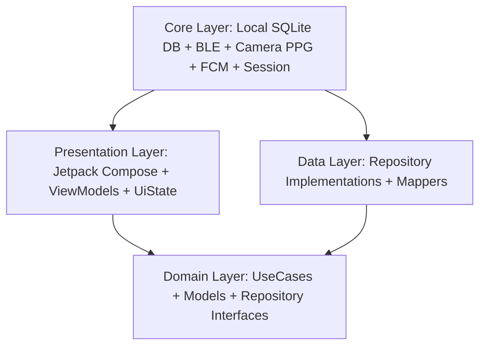

# 🏥 FamilyCare – Nền Tảng Chăm Sóc Sức Khỏe Gia Đình Đa Thế Hệ & Cảnh Báo Khẩn Cấp

> **Ứng dụng di động Android Native 100% Kotlin hiện đại**, kết hợp trí tuệ nhân tạo **Google Gemini AI**, đo nhịp tim quang học qua camera (**Camera PPG**), đồng hồ thông minh (**BLE Smartwatch**), quét đơn thuốc (**ML Kit OCR**), và mạng lưới an toàn khẩn cấp **SOS một chạm**.

---

## 📑 MỤC LỤC
1. [Giới Thiệu Tổng Quan](#1-giới-thiệu-tổng-quan)
2. [Ngôn Ngữ & Công Nghệ Sử Dụng (Tech Stack)](#2-ngôn-ngữ--công-nghệ-sử-dụng-tech-stack)
3. [Kiến Trúc Ứng Dụng (Clean Architecture & MVVM)](#3-kiến-trúc-ứng-dụng-clean-architecture--mvvm)
4. [Bản Đồ Chi Tiết Từng File Trong Dự Án (File-by-File Breakdown)](#4-bản-đồ-chi-tiết-từng-file-trong-dự-án)
   - [Gốc Ứng Dụng (Root Application)](#41-gốc-ứng-dụng-root-application)
   - [Tầng Core (Hạ tầng, CSDL, Phần cứng & Hệ thống)](#42-tầng-core-core-layer)
   - [Tầng Domain (Nghiệp vụ thuần túy, Models & UseCases)](#43-tầng-domain-domain-layer)
   - [Tầng Data (Triển khai Repository & Nguồn dữ liệu)](#44-tầng-data-data-layer)
   - [Tầng Presentation (Giao diện người dùng & ViewModels)](#45-tầng-presentation-ui--viewmodels)
   - [Tầng Theme (Hệ thống thiết kế Warm Cream Editorial Wellness)](#46-tầng-theme-design-system)
5. [Quy Trình Cài Đặt & Đóng Gói (Build & Installation)](#5-quy-trình-cài-đặt--đóng-gói-build--installation)

---

## 1. GIỚI THIỆU TỔNG QUAN

**FamilyCare** là giải pháp công nghệ toàn diện kết nối các thế hệ trong gia đình:
* **Đối với người cao tuổi / Người cần chăm sóc:** 
  - Giao diện thân thiện, cỡ chữ lớn, độ tương phản dịu mắt theo phong cách *Warm Cream Editorial Wellness*.
  - Đo nhịp tim trực tiếp không cần thiết bị ngoài chỉ bằng cách đặt ngón tay lên đèn flash camera sau (**Camera PPG**).
  - Quét đơn thuốc viết tay hoặc vỏ hộp thuốc bằng camera để tự động lập lịch uống thuốc (**ML Kit OCR**).
  - Báo thức nhắc uống thuốc cưỡng bức với cữ sáng/trưa/chiều/tối, đè lên màn hình khóa và nhắc nhở đúng giờ.
  - Nút khẩn cấp **SOS 1-chạm**: Tự động hú còi cứu hộ âm lượng tối đa, bật rung cực mạnh, lấy tọa độ GPS thời gian thực và gửi thông báo đỏ đến điện thoại người thân.
* **Đối với con cái / Trưởng gia đình (Admin):**
  - Theo dõi liên tục các chỉ số sinh tồn (Huyết áp, Đường huyết, Nhịp tim, SpO2) của cha mẹ từ xa.
  - Tự động nhận cảnh báo đẩy độ ưu tiên cao khi chỉ số của người thân vượt ngưỡng an toàn.
  - Trợ lý sức khỏe ảo **AI Copilot (Gemini)** thấu hiểu bệnh nền, phân tích đơn thuốc và giải thích chỉ số y khoa ân cần.
  - Xuất báo cáo hồ sơ bệnh án định kỳ dạng file PDF 7 ngày có đầy đủ bảng biểu và đồ thị để gửi cho bác sĩ điều trị.

---

## 2. NGÔN NGỮ & CÔNG NGHỆ SỬ DỤNG (TECH STACK)

| Hạng mục | Công nghệ / Thư viện sử dụng | Mục đích & Chi tiết triển khai |
| :--- | :--- | :--- |
| **Ngôn ngữ** | **Kotlin 100% (Kotlin 2.x)** | Đảm bảo an toàn bộ nhớ (Null Safety), Coroutines, Flow, Extension Functions. |
| **Giao diện (UI)** | **Jetpack Compose (Material 3)** | Xây dựng UI khai báo (Declarative UI), hoạt ảnh mượt mà 60/120 FPS. |
| **Phong cách thiết kế** | **Warm Cream Editorial Wellness** | Tông màu be dịu ấm `#FBF9F5`, xanh mòng két `#006A6A`, mang lại cảm giác an tâm y khoa gia đình. |
| **Kiến trúc** | **Clean Architecture + MVVM** | Tách biệt Presentation - Domain - Data - Core; luồng dữ liệu một chiều **UDF (StateFlow)**. |
| **Cơ sở dữ liệu** | **SQLite OpenHelper + Room DAO** | Lưu trữ cục bộ Offline-first, hỗ trợ đa tổ ấm, đồng bộ dữ liệu thời gian thực. |
| **Trí tuệ nhân tạo (AI)** | **Google Gemini Pro / Flash REST API** | Trợ lý y tế ảo AI Copilot, kỹ thuật **Context Injection** nạp bệnh nền và chỉ số đo của người bệnh. |
| **Thị giác máy tính (OCR)** | **Google ML Kit Text Recognition** | Quét văn bản trên đơn thuốc/hộp thuốc trực tiếp trên thiết bị (On-Device). |
| **Đo nhịp tim quang học** | **CameraX + ImageAnalysis** | Bật đèn flash, phân tích kênh màu Đỏ mao mạch đầu ngón tay ở 30 FPS (**PPG Algorithm**). |
| **Đồng hồ thông minh** | **Android Bluetooth Low Energy (BLE)** | Quét và kết nối GATT Client đọc nhịp tim thời gian thực và thời lượng pin smartwatch. |
| **Định vị & Bản đồ** | **Google Play Services Location** | `FusedLocationProviderClient` bắt tọa độ GPS chuẩn xác khi bấm nút SOS. |
| **Cảnh báo khẩn cấp** | **Firebase Cloud Messaging (FCM)** | Thông báo đẩy độ ưu tiên cao nhất (`high_priority`), còi hú cứu nạn `STREAM_ALARM`. |
| **Báo thức nhắc thuốc** | **Android AlarmManager** | `setExactAndAllowWhileIdle()` xuyên qua chế độ ngủ sâu Doze Mode của Android. |
| **Xác thực người dùng** | **Google Sign-In OAuth 2.0 & Email** | Hỗ trợ đăng nhập một chạm bằng tài khoản Google hoặc tài khoản Email độc lập. |
| **Xuất báo cáo** | **iText PDF / Android PdfDocument** | Kết xuất hồ sơ bệnh án chuẩn A4 có bảng chỉ số, biểu đồ và thông tin bảo hiểm. |

---

## 3. KIẾN TRÚC ỨNG DỤNG (CLEAN ARCHITECTURE & MVVM)

Ứng dụng được tổ chức theo 4 tầng kiến trúc tách biệt hoàn toàn theo nguyên lý Dependency Inversion:



1. **Presentation Layer:** Quản lý giao diện bằng Jetpack Compose, hiển thị dữ liệu qua `StateFlow` trong các ViewModel, không chứa logic nghiệp vụ.
2. **Domain Layer:** Trọng tâm của ứng dụng; chứa các Data Model nghiệp vụ thuần túy, hợp đồng Repository Interfaces và các Use Case độc lập (không phụ thuộc bất kỳ thư viện Android framework nào).
3. **Data Layer:** Triển khai các Repository Interfaces, truy vấn và tổng hợp dữ liệu từ SQLite Database, Shared Preferences và Cloud APIs.
4. **Core Layer:** Cung cấp hạ tầng kỹ thuật: trình quản lý cảm biến camera PPG, trình quản lý Bluetooth LE, điều khiển còi hú, cơ sở dữ liệu SQLite và bộ nhớ phiên người dùng.

---

## 4. BẢN ĐỒ CHI TIẾT TỪNG FILE TRONG DỰ ÁN

Toàn bộ mã nguồn Kotlin của ứng dụng nằm tại thư mục: `app/src/main/java/com/familycare/app/`. Dưới đây là chức năng và nhiệm vụ cụ thể của từng tệp tin:

### 4.1. Gốc Ứng Dụng (Root Application)
* [`FamilyCareApp.kt`](file:///d:/APP/app/src/main/java/com/familycare/app/FamilyCareApp.kt): 
  - Lớp `Application` khởi động đầu tiên khi ứng dụng được kích hoạt.
  - Thiết lập các kênh thông báo Android Notification Channel: kênh khẩn cấp SOS (`HIGH`/`MAX` độ ưu tiên), kênh nhắc lịch uống thuốc và kênh cảnh báo y tế.
  - Khởi tạo bộ điều khiển còi hú khẩn cấp và cấu hình môi trường toàn cục.
* [`MainActivity.kt`](file:///d:/APP/app/src/main/java/com/familycare/app/MainActivity.kt): 
  - `ComponentActivity` duy nhất của ứng dụng (Single-Activity Architecture).
  - Cấu hình cửa sổ không viền (Edge-to-Edge), nạp Theme *FamilyCareTheme* và điều hướng đến `AppNavHost`.

---

### 4.2. Tầng Core (Hạ tầng, CSDL, Phần cứng & Hệ thống)
Thư mục: `com.familycare.app.core`

#### 📡 Bluetooth LE (`core/ble/`)
* [`SmartwatchBleManager.kt`](file:///d:/APP/app/src/main/java/com/familycare/app/core/ble/SmartwatchBleManager.kt):
  - Quản lý Bluetooth Low Energy: quét tìm thiết bị vòng tay / đồng hồ đo sức khỏe gần kề.
  - Kết nối GATT Client, đăng ký dịch vụ `Heart Rate Service` (UUID `0x180D`) và `Battery Service` (UUID `0x180F`).
  - Phát sóng luồng nhịp tim thời gian thực và % pin về giao diện qua `StateFlow`.

#### 🔑 Phiên làm việc & Trạng thái (`core/common/`)
* [`SessionManager.kt`](file:///d:/APP/app/src/main/java/com/familycare/app/core/common/SessionManager.kt):
  - Quản lý SharedPreferences lưu trữ phiên đăng nhập: `userId`, `userName`, `userEmail`, `userRole` (`ADMIN` / `MEMBER`), `familyId`, `familyName`, `inviteCode`.
  - Cung cấp hàm xóa sạch phiên làm việc khi người dùng đăng xuất (`clearSession`).
* [`Resource.kt`](file:///d:/APP/app/src/main/java/com/familycare/app/core/common/Resource.kt):
  - Sealed class gói trạng thái dữ liệu generic: `Success<T>`, `Error<T>`, `Loading<T>`.

#### 💾 Cơ sở dữ liệu Cục bộ (`core/database/`)
* [`AppDatabase.kt`](file:///d:/APP/app/src/main/java/com/familycare/app/core/database/AppDatabase.kt):
  - Khởi tạo SQLite OpenHelper (`familycare_db.db`), quản lý phiên bản CSDL và nâng cấp Schema (Version 4).
  - Triển khai toàn bộ các DAO: `UserDaoImpl`, `HealthMetricDaoImpl`, `MedicineDaoImpl`, `MedicationLogDaoImpl`, `AppointmentDaoImpl`, `AlertDaoImpl`.
  - Quản lý tính toàn vẹn đa tổ ấm, đồng bộ tài khoản Trưởng gia đình mặc định và mã mời `FAM-8606`.
* [`UserEntity.kt`](file:///d:/APP/app/src/main/java/com/familycare/app/core/database/UserEntity.kt) & [`UserDao.kt`](file:///d:/APP/app/src/main/java/com/familycare/app/core/database/UserDao.kt):
  - Thực thể bảng `users`: lưu thông tin tài khoản, mật khẩu, họ tên, vai trò, mã tổ ấm, nhóm máu, bệnh nền JSON, dị ứng JSON, số điện thoại, địa chỉ.
  - DAO xử lý đăng ký, đăng nhập, đổi mật khẩu, cập nhật tổ ấm và truy vấn danh sách thành viên.
* [`HealthMetricEntity.kt`](file:///d:/APP/app/src/main/java/com/familycare/app/core/database/HealthMetricEntity.kt) & [`HealthMetricDao.kt`](file:///d:/APP/app/src/main/java/com/familycare/app/core/database/HealthMetricDao.kt):
  - Thực thể bảng `health_metrics`: lưu từng lần đo huyết áp (tâm thu/tâm trương), đường huyết, nhịp tim, SpO2, cờ đo qua camera PPG.
  - DAO truy vấn lịch sử đo theo từng thành viên và lấy chỉ số mới nhất.
* [`MedicineEntity.kt`](file:///d:/APP/app/src/main/java/com/familycare/app/core/database/MedicineEntity.kt) & [`MedicineDao.kt`](file:///d:/APP/app/src/main/java/com/familycare/app/core/database/MedicineDao.kt):
  - Thực thể bảng `medicines`: lưu tên thuốc, hàm lượng, công dụng, cách dùng, danh sách giờ uống JSON, ngày bắt đầu/kết thúc.
  - DAO thêm/sửa/xóa thuốc theo thành viên gia đình.
* [`MedicationLogEntity.kt`](file:///d:/APP/app/src/main/java/com/familycare/app/core/database/MedicationLogEntity.kt) & [`MedicationLogDao.kt`](file:///d:/APP/app/src/main/java/com/familycare/app/core/database/MedicationLogDao.kt):
  - Thực thể bảng `medication_logs`: nhật ký từng liều thuốc trong ngày cụ thể (đã uống, bỏ qua, giờ uống thực tế).
  - Hỗ trợ tính toán tỷ lệ tuân thủ uống thuốc và tự động reset trạng thái khi sang ngày mới.
* [`AppointmentEntity.kt`](file:///d:/APP/app/src/main/java/com/familycare/app/core/database/AppointmentEntity.kt) & [`AppointmentDao.kt`](file:///d:/APP/app/src/main/java/com/familycare/app/core/database/AppointmentDao.kt):
  - Thực thể bảng `appointments`: lưu lịch hẹn khám tại bệnh viện, chuyên khoa, bác sĩ, ngày giờ hẹn và ghi chú.
* [`AlertEntity.kt`](file:///d:/APP/app/src/main/java/com/familycare/app/core/database/AlertEntity.kt) & [`AlertDao.kt`](file:///d:/APP/app/src/main/java/com/familycare/app/core/database/AlertDao.kt):
  - Thực thể bảng `alerts`: lưu trữ các cảnh báo vượt ngưỡng sinh tồn, cảnh báo khẩn cấp SOS kèm tọa độ vị trí.
* [`Converters.kt`](file:///d:/APP/app/src/main/java/com/familycare/app/core/database/Converters.kt):
  - Chuyển đổi qua lại giữa danh sách List/JSON sang định dạng lưu trữ SQLite.

#### 🚨 Cứu hộ & Thông báo khẩn cấp (`core/emergency/`, `core/network/`, `core/notification/`)
* [`EmergencyManager.kt`](file:///d:/APP/app/src/main/java/com/familycare/app/core/emergency/EmergencyManager.kt):
  - Điều phối quy trình SOS khẩn cấp: lấy tọa độ GPS từ `FusedLocationProviderClient`, phát còi hú và kích hoạt thông báo đẩy.
* [`EmergencySirenController.kt`](file:///d:/APP/app/src/main/java/com/familycare/app/core/emergency/EmergencySirenController.kt):
  - Điều khiển âm thanh còi hú cứu hộ qua `MediaPlayer` với luồng âm thanh báo thức `STREAM_ALARM` (phát âm lượng 100% bất kể máy đang ở chế độ im lặng/rung).
  - Tích hợp mô-tơ rung với chu kỳ nhịp đập cứu hộ dồn dập.
* [`EmergencyPayload.kt`](file:///d:/APP/app/src/main/java/com/familycare/app/core/emergency/EmergencyPayload.kt):
  - Cấu trúc dữ liệu gói tin SOS truyền qua mạng (họ tên người bấm, tọa độ vĩ độ/kinh độ, địa chỉ, thời điểm).
* [`EmergencyNotificationHelper.kt`](file:///d:/APP/app/src/main/java/com/familycare/app/core/network/EmergencyNotificationHelper.kt):
  - Gửi yêu cầu HTTP POST Dispatcher thông báo khẩn cấp FCM High-Priority đến các thiết bị của người thân.
* [`MyFirebaseMessagingService.kt`](file:///d:/APP/app/src/main/java/com/familycare/app/core/notification/MyFirebaseMessagingService.kt) & [`FamilyCareMessagingService.kt`](file:///d:/APP/app/src/main/java/com/familycare/app/core/notification/FamilyCareMessagingService.kt):
  - Dịch vụ Firebase nhận thông báo nền, kích hoạt màn hình cảnh báo đỏ toàn màn hình khi có tin báo SOS từ người thân trong gia đình.

---

### 4.3. Tầng Domain (Nghiệp vụ thuần túy, Models & UseCases)
Thư mục: `com.familycare.app.domain`

#### 📦 Domain Models (`domain/model/`)
* [`User.kt`](file:///d:/APP/app/src/main/java/com/familycare/app/domain/model/User.kt): Mô hình người dùng trong nghiệp vụ.
* [`UserHealthContext.kt`](file:///d:/APP/app/src/main/java/com/familycare/app/domain/model/UserHealthContext.kt): Tổng hợp hồ sơ sức khỏe toàn diện của một thành viên (tuổi tác, tiền sử bệnh nền, thuốc đang uống, các chỉ số đo gần nhất) để tiêm vào bối cảnh của Trợ lý AI.
* [`HealthMetric.kt`](file:///d:/APP/app/src/main/java/com/familycare/app/domain/model/HealthMetric.kt): Mô hình chỉ số sinh tồn (huyết áp, đường huyết, nhịp tim, nhiệt độ, SpO2).
* [`HealthThreshold.kt`](file:///d:/APP/app/src/main/java/com/familycare/app/domain/model/HealthThreshold.kt) & [`ThresholdAnalysisResult.kt`](file:///d:/APP/app/src/main/java/com/familycare/app/domain/model/ThresholdAnalysisResult.kt): Định nghĩa các ngưỡng cảnh báo y khoa an toàn (ví dụ: huyết áp tâm thu $\ge 140$ mmHg là tăng huyết áp) và kết quả phân tích bất thường.
* [`Medicine.kt`](file:///d:/APP/app/src/main/java/com/familycare/app/domain/model/Medicine.kt): Mô hình thuốc và lịch trình dùng thuốc trong ngày.
* [`Appointment.kt`](file:///d:/APP/app/src/main/java/com/familycare/app/domain/model/Appointment.kt): Mô hình lịch hẹn khám bệnh định kỳ.
* [`Alert.kt`](file:///d:/APP/app/src/main/java/com/familycare/app/domain/model/Alert.kt): Mô hình cảnh báo y tế hiển thị trên hộp thư thông báo.
* [`NearbyHospital.kt`](file:///d:/APP/app/src/main/java/com/familycare/app/domain/model/NearbyHospital.kt): Danh bạ các bệnh viện cấp cứu gần nhất kèm số điện thoại cấp cứu và tọa độ vị trí.
* [`ChatMessage.kt`](file:///d:/APP/app/src/main/java/com/familycare/app/domain/model/ChatMessage.kt): Tin nhắn trao đổi giữa người dùng và Trợ lý AI Copilot.
* [`SmartwatchDevice.kt`](file:///d:/APP/app/src/main/java/com/familycare/app/domain/model/SmartwatchDevice.kt): Trạng thái thiết bị đồng hồ thông minh kết nối qua Bluetooth.

#### 🎯 Use Cases (`domain/usecase/`)
* [`AnalyzeThresholdUseCase.kt`](file:///d:/APP/app/src/main/java/com/familycare/app/domain/usecase/AnalyzeThresholdUseCase.kt):
  - Phân tích chuỗi chỉ số đo sinh tồn trong cửa sổ 48 giờ.
  - Tự động phát hiện bất thường: nếu phát hiện **3 lần liên tiếp vượt ngưỡng an toàn**, tự động sinh cảnh báo nguy cơ gửi đến người giám hộ.
* [`GetHealthContextUseCase.kt`](file:///d:/APP/app/src/main/java/com/familycare/app/domain/usecase/GetHealthContextUseCase.kt):
  - Tập hợp toàn bộ dữ liệu từ CSDL của người dùng: tuổi, nhóm máu, bệnh mạn tính, dị ứng, thuốc hôm nay và chỉ số sinh tồn mới nhất.
  - Chuẩn bị gói ngữ cảnh đầy đủ để AI Copilot hiểu rõ thể trạng bệnh nhân trước khi trả lời.
* [`SendChatMessageUseCase.kt`](file:///d:/APP/app/src/main/java/com/familycare/app/domain/usecase/SendChatMessageUseCase.kt):
  - Kết nối với Google Gemini Pro REST API, đính kèm `SystemInstruction` y tế chuyên môn và gửi nhận tin nhắn hội thoại.

#### 📑 Repository Interfaces (`domain/repository/`)
* Chứa các hợp đồng trừu tượng: `AuthRepository.kt`, `HealthMetricRepository.kt`, `MedicineRepository.kt`, `AppointmentRepository.kt`, `AlertRepository.kt`, `HealthAiRepository.kt`.

---

### 4.4. Tầng Data (Triển khai Repository & Nguồn dữ liệu)
Thư mục: `com.familycare.app.data/repository/`
* [`MedicineRepositoryImpl.kt`](file:///d:/APP/app/src/main/java/com/familycare/app/data/repository/MedicineRepositoryImpl.kt): Triển khai các thao tác với đơn thuốc và nhật ký uống thuốc.
* [`AppointmentRepositoryImpl.kt`](file:///d:/APP/app/src/main/java/com/familycare/app/data/repository/AppointmentRepositoryImpl.kt): Triển khai quản lý lịch tái khám bệnh viện.
* [`AlertRepositoryImpl.kt`](file:///d:/APP/app/src/main/java/com/familycare/app/data/repository/AlertRepositoryImpl.kt): Triển khai lưu trữ và truy vấn cảnh báo y tế.
* [`HealthAiRepositoryImpl.kt`](file:///d:/APP/app/src/main/java/com/familycare/app/data/repository/HealthAiRepositoryImpl.kt): Triển khai cuộc gọi mạng đến API của Google Gemini, xử lý phản hồi JSON và bắt lỗi timeout/mất mạng.

---

### 4.5. Tầng Presentation (UI & ViewModels)
Thư mục: `com.familycare.app.presentation`

#### 🔐 Xác thực & Thiết lập tổ ấm (`presentation/auth/`)
* [`LoginScreen.kt`](file:///d:/APP/app/src/main/java/com/familycare/app/presentation/auth/LoginScreen.kt):
  - Màn hình Đăng nhập / Đăng ký hiện đại với thanh gạt dạng viên thuốc bo tròn (Segmented Pill Switcher).
  - Tích hợp đăng nhập Email an toàn và nút bấm **Tiếp tục với Google** (Google Sign-In One-Tap).
* [`FamilySetupScreen.kt`](file:///d:/APP/app/src/main/java/com/familycare/app/presentation/auth/FamilySetupScreen.kt):
  - Màn hình thiết lập tổ ấm đầu tiên: cho phép người dùng **Tạo tổ ấm mới** (tự động sinh mã mời ngẫu nhiên, phong làm Trưởng gia đình) hoặc **Nhập mã mời** (gia nhập vào gia đình có sẵn với vai trò Thành viên).

#### 🏠 Trang chủ tổng quan (`presentation/home/`)
* [`HomeScreen.kt`](file:///d:/APP/app/src/main/java/com/familycare/app/presentation/home/HomeScreen.kt):
  - Bảng điều khiển chính (Dashboard): Lời chào theo giờ thực tế của thiết bị, thẻ tóm tắt liều thuốc trong ngày (hiển thị `[✓ Hoàn thành]` khi uống đủ), thẻ chỉ số sinh tồn của người thân.
  - Nút khẩn cấp SOS nổi dạng hình tròn màu đỏ ở góc dưới bên phải (`size = 54.dp`).
  - Hỗ trợ thêm thành viên mới trực tiếp qua Dialog.
* [`HomeViewModel.kt`](file:///d:/APP/app/src/main/java/com/familycare/app/presentation/home/HomeViewModel.kt) & [`HomeUiState.kt`](file:///d:/APP/app/src/main/java/com/familycare/app/presentation/home/HomeUiState.kt):
  - Quản lý logic nạp dữ liệu trang chủ, lọc thành viên theo `familyId`, tự động làm mới khi sang ngày mới hoặc khi chuyển đổi người dùng.

#### 🩺 Chỉ số sinh tồn & Đo quang học PPG (`presentation/biometrics/`)
* [`BiometricsScreen.kt`](file:///d:/APP/app/src/main/java/com/familycare/app/presentation/biometrics/BiometricsScreen.kt):
  - Màn hình theo dõi 4 chỉ số: Huyết áp, Nhịp tim, Đường huyết, Nhiệt độ.
  - Tích hợp thanh chọn thành viên dạng viên thuốc `MemberSwitcherRow` chuẩn phong cách tối giản.
  - Nút thêm chỉ số thủ công hoặc nói bằng giọng nói tiếng Việt.
* [`AddMetricDialog.kt`](file:///d:/APP/app/src/main/java/com/familycare/app/presentation/biometrics/dialog/AddMetricDialog.kt):
  - Hộp thoại nhập chỉ số sinh tồn, tự động phân tích giọng nói nhận dạng số tâm thu/tâm trương.
* [`BiometricsLineChart.kt`](file:///d:/APP/app/src/main/java/com/familycare/app/presentation/biometrics/chart/BiometricsLineChart.kt):
  - Biểu đồ đường vẽ bằng Canvas biểu diễn diễn biến huyết áp và nhịp tim trong 7 ngày hoặc 30 ngày.
* **Module đo nhịp tim bằng Camera (`presentation/biometrics/ppg/`):**
  - [`CameraPpgScreen.kt`](file:///d:/APP/app/src/main/java/com/familycare/app/presentation/biometrics/ppg/CameraPpgScreen.kt): Giao diện đo nhịp tim quang học: vòng tròn hướng dẫn đặt ngón tay, đồng hồ đếm ngược 15 giây, hiển thị nhịp tim tức thời.
  - [`CameraPpgViewModel.kt`](file:///d:/APP/app/src/main/java/com/familycare/app/presentation/biometrics/ppg/CameraPpgViewModel.kt): Quản lý luồng trạng thái đo (`IDLE`, `MEASURING`, `COMPLETED`, `ERROR`), lưu kết quả vào Room DB.
  - [`CameraPpgAnalyzer.kt`](file:///d:/APP/app/src/main/java/com/familycare/app/presentation/biometrics/ppg/CameraPpgAnalyzer.kt): Bộ phân tích `ImageAnalysis.Analyzer` của CameraX; tự động bật đèn Flash, đọc ma trận điểm ảnh RGB, tính giá trị trung bình kênh đỏ (Red intensity) trên từng khung hình.
  - [`PpgSignalProcessor.kt`](file:///d:/APP/app/src/main/java/com/familycare/app/presentation/biometrics/ppg/PpgSignalProcessor.kt): Thuật toán xử lý tín hiệu: bộ lọc thông dải (Bandpass Filter 0.75Hz - 3.5Hz) loại bỏ nhiễu rung tay, thuật toán phát hiện đỉnh sóng (Peak Detection) để tính nhịp tim BPM và độ bão hòa oxy SpO2.
  - [`PpgWaveformView.kt`](file:///d:/APP/app/src/main/java/com/familycare/app/presentation/biometrics/ppg/PpgWaveformView.kt): Thành phần Canvas vẽ dạng sóng xung nhịp tim thời gian thực (Pulse Waveform) nhấp nháy sinh động.

#### 🤖 Trợ lý sức khỏe ảo AI Copilot (`presentation/ai_assistant/`)
* [`AiAssistantScreen.kt`](file:///d:/APP/app/src/main/java/com/familycare/app/presentation/ai_assistant/AiAssistantScreen.kt):
  - Màn hình đàm thoại trực tiếp với Bác sĩ AI.
  - Hỗ trợ câu hỏi mẫu nhanh (thuốc này uống lúc nào, chỉ số huyết áp này có nguy hiểm không).
  - Tích hợp nút Micro thu âm giọng nói tiếng Việt qua `SpeechRecognizer`.
* [`AiAssistantViewModel.kt`](file:///d:/APP/app/src/main/java/com/familycare/app/presentation/ai_assistant/AiAssistantViewModel.kt) & [`AiAssistantUiState.kt`](file:///d:/APP/app/src/main/java/com/familycare/app/presentation/ai_assistant/AiAssistantUiState.kt):
  - Tự động nạp bối cảnh bệnh án của người thân đang chọn, gửi câu hỏi đến Gemini và nhận phản hồi streaming/text ân cần.

#### 💊 Kế hoạch uống thuốc (`presentation/schedule/`)
* [`HealthScheduleScreen.kt`](file:///d:/APP/app/src/main/java/com/familycare/app/presentation/schedule/HealthScheduleScreen.kt):
  - Màn hình lịch trình thuốc trong ngày chia theo 4 cữ rõ ràng: **Sáng (07:00)**, **Trưa (11:30)**, **Chiều (17:00)**, **Tối (20:30)**.
  - Nút xác nhận uống thuốc một chạm kèm hiệu ứng đánh dấu `[✓ Hoàn thành]`.
  - Thanh chọn thành viên ngang (`MemberSwitcherRow`) chuyển đổi lịch thuốc giữa các thành viên mượt mà.
* [`HealthScheduleViewModel.kt`](file:///d:/APP/app/src/main/java/com/familycare/app/presentation/schedule/HealthScheduleViewModel.kt) & [`HealthScheduleUiState.kt`](file:///d:/APP/app/src/main/java/com/familycare/app/presentation/schedule/HealthScheduleUiState.kt):
  - Tự động kiểm tra sang ngày mới và khởi tạo trạng thái thuốc chưa uống; theo dõi sự thay đổi của đơn thuốc theo thời gian thực.
* **Báo thức & Nhắc nhở (`presentation/medication/`):**
  - [`MedicationAlarmScheduler.kt`](file:///d:/APP/app/src/main/java/com/familycare/app/presentation/medication/MedicationAlarmScheduler.kt): Lập lịch chuông báo thuốc với `AlarmManager`.
  - [`MedicationReminderReceiver.kt`](file:///d:/APP/app/src/main/java/com/familycare/app/presentation/medication/MedicationReminderReceiver.kt): Bộ thu nhận tín hiệu báo thức đến giờ.
  - [`MedicationAlarmService.kt`](file:///d:/APP/app/src/main/java/com/familycare/app/presentation/medication/MedicationAlarmService.kt): Dịch vụ phát chuông báo thức toàn màn hình.

#### 🚨 Trung tâm cứu nạn khẩn cấp SOS (`presentation/emergency/`)
* [`EmergencyScreen.kt`](file:///d:/APP/app/src/main/java/com/familycare/app/presentation/emergency/EmergencyScreen.kt):
  - Trung tâm kích hoạt SOS: Thẻ người thân tiếp nhận khẩn cấp, thẻ danh bạ khẩn cấp thật lấy trực tiếp từ CSDL (hiển thị số điện thoại thật hoặc *"Chưa có thông tin"*), danh sách bệnh viện cấp cứu gần nhất kèm nút mở Google Maps và nút gọi ngay `115`.
  - Nền Ambient Warm Cream hài hòa tuyệt đối với toàn bộ ứng dụng.
* [`EmergencyViewModel.kt`](file:///d:/APP/app/src/main/java/com/familycare/app/presentation/emergency/EmergencyViewModel.kt) & [`EmergencyUiState.kt`](file:///d:/APP/app/src/main/java/com/familycare/app/presentation/emergency/EmergencyUiState.kt):
  - Lấy tọa độ GPS thiết bị, định vị bệnh viện gần kề, trích xuất số điện thoại thật của chủ hộ/người thân.
* [`SosButton.kt`](file:///d:/APP/app/src/main/java/com/familycare/app/presentation/emergency/SosButton.kt):
  - Nút bấm SOS thông minh chống chạm nhầm: yêu cầu nhấn giữ liên tục **2 giây** với vòng tròn hoạt ảnh đếm ngược; thả tay trước 2s sẽ tự động hủy.
* [`EmergencyAlertReceiverActivity.kt`](file:///d:/APP/app/src/main/java/com/familycare/app/presentation/emergency/EmergencyAlertReceiverActivity.kt):
  - Màn hình báo động đỏ khẩn cấp đè lên màn hình khóa khi nhận được tín hiệu SOS từ người thân.

#### 🔔 Hộp thư cảnh báo y tế (`presentation/alert/`)
* [`AlertCenterScreen.kt`](file:///d:/APP/app/src/main/java/com/familycare/app/presentation/alert/AlertCenterScreen.kt) & [`AlertListScreen.kt`](file:///d:/APP/app/src/main/java/com/familycare/app/presentation/alert/AlertListScreen.kt):
  - Danh sách cảnh báo sức khỏe (vượt ngưỡng, cấp cứu SOS), đánh dấu đã đọc hoặc giải quyết.
* [`AlertViewModel.kt`](file:///d:/APP/app/src/main/java/com/familycare/app/presentation/alert/AlertViewModel.kt) & [`AlertUiState.kt`](file:///d:/APP/app/src/main/java/com/familycare/app/presentation/alert/AlertUiState.kt):
  - Quản lý trạng thái thông báo theo từng tổ ấm gia đình.

#### 🏥 Lịch khám & Nhắc hẹn (`presentation/appointment/`)
* [`AppointmentScreen.kt`](file:///d:/APP/app/src/main/java/com/familycare/app/presentation/appointment/AppointmentScreen.kt):
  - Danh sách lịch khám tại bệnh viện, thêm/sửa/xóa lịch hẹn.
* [`AppointmentViewModel.kt`](file:///d:/APP/app/src/main/java/com/familycare/app/presentation/appointment/AppointmentViewModel.kt):
  - Tương tác với CSDL SQLite và lập lịch chuông báo trước giờ khám.
* [`AppointmentAlarmScheduler.kt`](file:///d:/APP/app/src/main/java/com/familycare/app/presentation/appointment/AppointmentAlarmScheduler.kt) & [`AppointmentReminderReceiver.kt`](file:///d:/APP/app/src/main/java/com/familycare/app/presentation/appointment/AppointmentReminderReceiver.kt):
  - Quản lý báo thức nhắc hẹn khám bệnh.

#### 📷 Quét đơn thuốc bằng AI (`presentation/ocr/`)
* [`OcrPrescriptionScreen.kt`](file:///d:/APP/app/src/main/java/com/familycare/app/presentation/ocr/OcrPrescriptionScreen.kt):
  - Chụp ảnh đơn thuốc, khoanh vùng nhận diện và xem lại văn bản đã nhận diện.
* [`ScanPrescriptionViewModel.kt`](file:///d:/APP/app/src/main/java/com/familycare/app/presentation/ocr/ScanPrescriptionViewModel.kt):
  - Gửi ảnh đến Google ML Kit Vision Text Recognition, áp dụng biểu thức chính quy (Regex) để tự động trích xuất tên thuốc và liều lượng.

#### ⌚ Kết nối Smartwatch (`presentation/smartwatch/`)
* [`SmartwatchScreen.kt`](file:///d:/APP/app/src/main/java/com/familycare/app/presentation/smartwatch/SmartwatchScreen.kt):
  - Màn hình quét thiết bị BLE, hiển thị thẻ trạng thái kết nối, nhịp tim trực tiếp và mức pin.
* [`SmartwatchViewModel.kt`](file:///d:/APP/app/src/main/java/com/familycare/app/presentation/smartwatch/SmartwatchViewModel.kt) & [`SmartwatchUiState.kt`](file:///d:/APP/app/src/main/java/com/familycare/app/presentation/smartwatch/SmartwatchUiState.kt):
  - Quản lý vòng đời kết nối Bluetooth với `SmartwatchBleManager`.

#### 👤 Hồ sơ y bạ & Xuất báo cáo PDF (`presentation/profile/`)
* [`ProfileScreen.kt`](file:///d:/APP/app/src/main/java/com/familycare/app/presentation/profile/ProfileScreen.kt):
  - Quản lý thông tin cá nhân và hồ sơ bệnh án (nhóm máu, tiền sử bệnh, dị ứng).
  - Quản lý danh sách thành viên trong gia đình, mã mời tổ ấm.
  - Nút xuất báo cáo y tế PDF và đăng xuất tài khoản.
* [`ProfileViewModel.kt`](file:///d:/APP/app/src/main/java/com/familycare/app/presentation/profile/ProfileViewModel.kt) & [`ProfileUiState.kt`](file:///d:/APP/app/src/main/java/com/familycare/app/presentation/profile/ProfileUiState.kt):
  - Cập nhật thông tin hồ sơ vào CSDL và đồng bộ dữ liệu người thân.
* [`HealthReportPdfExporter.kt`](file:///d:/APP/app/src/main/java/com/familycare/app/presentation/profile/HealthReportPdfExporter.kt):
  - Trình kết xuất file PDF hồ sơ bệnh án định kỳ 7 ngày chuẩn trang in A4.
  - Tự động vẽ bảng thông tin bệnh nhân, bảng chỉ số sinh tồn và tỷ lệ uống thuốc.
* [`PreviewMedicalReportScreen.kt`](file:///d:/APP/app/src/main/java/com/familycare/app/presentation/profile/PreviewMedicalReportScreen.kt):
  - Xem trước báo cáo y tế trực quan trên màn hình điện thoại trước khi chia sẻ hoặc in ấn.

#### 🧭 Điều hướng ứng dụng (`presentation/navigation/`)
* [`AppNavHost.kt`](file:///d:/APP/app/src/main/java/com/familycare/app/presentation/navigation/AppNavHost.kt):
  - Đồ thị điều hướng trung tâm (NavHost) điều phối chuyển tab và chuyển màn hình.
  - Thanh điều hướng đáy (`FamilyCareBottomBar`) phong cách nổi với **Nút Trợ lý AI ở chính giữa được nhô cao 12.dp** nổi bật.
* [`Screen.kt`](file:///d:/APP/app/src/main/java/com/familycare/app/presentation/navigation/Screen.kt):
  - Định nghĩa danh sách các Route điều hướng an toàn (`Login`, `FamilySetup`, `Dashboard`, `Biometrics`, `AiAssistant`, `Medication`, `Profile`, `SosPanic`...).

#### 🎨 Thành phần giao diện dùng chung (`presentation/common/`)
* [`FamilyCareAmbientBackground.kt`](file:///d:/APP/app/src/main/java/com/familycare/app/presentation/common/FamilyCareAmbientBackground.kt):
  - Lớp nền chuyển màu Ambient gradient mềm mại, bao bọc toàn bộ ứng dụng, tạo sự thư thái và ấm cúng.
* [`FamilyCareDesignSystem.kt`](file:///d:/APP/app/src/main/java/com/familycare/app/presentation/common/FamilyCareDesignSystem.kt):
  - Các thành phần UI thiết kế sẵn: Card, Button, Input Field, Badge theo đúng chuẩn tỷ lệ và bán kính bo góc của thiết kế.

---

### 4.6. Tầng Theme (Design System)
Thư mục: `com.familycare.app.ui.theme`
* [`Color.kt`](file:///d:/APP/app/src/main/java/com/familycare/app/ui/theme/Color.kt): 
  - Hệ thống bảng màu chuẩn *Warm Cream Editorial Wellness*:
    - `WarmCreamBackground` (`#FBF9F5`): Nền be sữa dịu mắt.
    - `WarmPrimaryTeal` (`#006A6A`): Xanh mòng két chủ đạo, mang tính y khoa tin cậy.
    - `WarmPrimaryHover` (`#008282`): Màu nhấn tương tác khi được chọn.
    - `WarmCreamSurface` (`#F2EFE9`): Bề mặt thẻ card phụ.
    - `WarmDivider` (`#E6E1D8`): Đường kẻ chia phần tinh tế.
    - `SosRed` (`#DC2626`): Màu đỏ cảnh báo khẩn cấp nổi bật.
* [`Theme.kt`](file:///d:/APP/app/src/main/java/com/familycare/app/ui/theme/Theme.kt): 
  - Cung cấp `FamilyCareTheme` cho toàn bộ ứng dụng, đồng bộ màu thanh trạng thái (StatusBar) và thanh điều hướng (NavigationBar).
* [`Type.kt`](file:///d:/APP/app/src/main/java/com/familycare/app/ui/theme/Type.kt): 
  - Cấu hình Typography với tỷ lệ chữ to rõ, dễ đọc cho người cao tuổi.

---

## 5. QUY TRÌNH CÀI ĐẶT & ĐÓNG GÓI (BUILD & INSTALLATION)

### 5.1. Yêu cầu môi trường
* **Hệ điều hành:** Windows 10/11, macOS hoặc Linux.
* **Android Studio:** Bản mới nhất (Android Studio Koala / Ladybug hoặc mới hơn).
* **JDK:** Java Development Kit version **17**.
* **Android SDK:**
  - `compileSdk`: **34** (Android 14)
  - `minSdk`: **26** (Android 8.0 Oreo)
  - `targetSdk`: **34**

### 5.2. Các bước mở dự án & Thiết lập
1. Clone dự án từ GitHub:
   ```bash
   git clone https://github.com/THM-B24DCCC206/FamilyCare.git
   cd FamilyCare
   git checkout develop
   ```
2. Mở thư mục dự án bằng **Android Studio**.
3. Chờ Gradle Sync hoàn tất tải các thư viện phụ thuộc.
4. Kiểm tra file cấu hình dịch vụ Firebase `app/google-services.json` đã có trong thư mục `app/`.

### 5.3. Kiểm tra biên dịch mã nguồn (Không đóng gói APK)
Để kiểm tra tính toàn vẹn cú pháp của toàn bộ code Kotlin mà không tốn thời gian đóng gói APK:
```bash
./gradlew compileDebugKotlin --no-daemon
```

### 5.4. Đóng gói file cài đặt APK
Để đóng gói file APK cài đặt trực tiếp lên điện thoại hoặc máy ảo:
```bash
./gradlew assembleDebug
```
* **Đường dẫn file APK sau khi đóng gói:**
  `app/build/outputs/apk/debug/app-debug.apk`
* File APK đã sẵn sàng để cài đặt trực tiếp vào bất kỳ thiết bị Android nào qua kết nối USB hoặc gửi qua Zalo/Drive.

---

## 👥 THÀNH VIÊN THỰC HIỆN DỰ ÁN
* **Đồ án:** Phát triển Ứng dụng Di động Chăm Sóc Sức Khỏe Gia Đình (FamilyCare)
* **Nhánh phát triển chính:** `develop`
* **Kho lưu trữ:** [THM-B24DCCC206 / FamilyCare](https://github.com/THM-B24DCCC206/FamilyCare)
